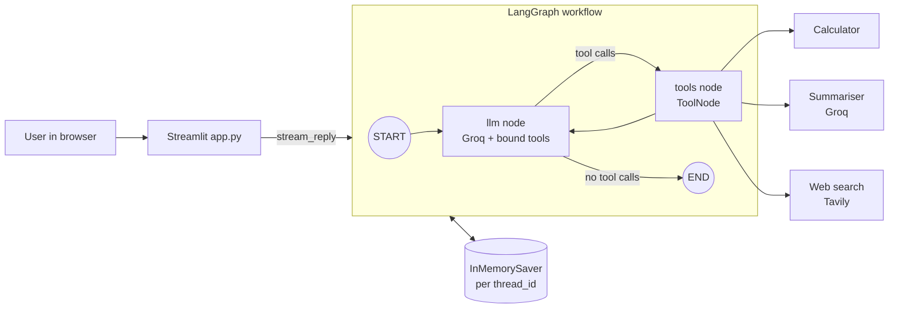

# General-Purpose AI Chatbot

A small, general-purpose AI chatbot built with **LangGraph**, **LangChain**, **Groq** and **Streamlit**. The assistant answers questions, does exact arithmetic with a calculator tool, summarises text with an LLM-powered tool, and searches the web for current information with Tavily. It remembers each conversation for the session and streams its replies.

## Features

- **Tool calling with a LangGraph loop**: the model decides when to call a tool, reads the result and answers.
- **Three tools**
  - **Calculator**: add, subtract, multiply, divide; handles division by zero, overflow and NaN; rounds to 12 significant digits.
  - **Summariser**: a focused LLM call that condenses text the user provides.
  - **Web search**: Tavily search (3 results, basic depth) with source URLs.
- **Conversation memory per session**: an in-memory checkpointer keyed by `thread_id`; "New conversation" starts a fresh thread.
- **Streaming replies** with a "Thinking..." indicator while tools run.
- **Tool transparency**: each answer shows which tools were used.
- **74 automated tests** (unit, mocked workflow, UI) plus 7 live smoke tests.

## Architecture



- **State**: `ChatState` holds `messages`, merged with the `add_messages` reducer.
- **LLM node**: prepends the system prompt on each call (not stored in state) and returns only the new message.
- **Routing**: `tools_condition` sends the turn to the tool node when the model requests tools, otherwise to `END`.
- **Errors**: tools return error messages for expected problems; `ToolNode(handle_tool_errors=True)` turns unexpected tool exceptions into messages instead of crashing.

## Project structure

```
app.py                               Streamlit UI
.streamlit/config.toml               Theme
src/general_purpose_ai_chatbot/chatbot/
    config.py                        Loads and validates environment variables
    model.py                         ChatGroq factory
    state.py                         ChatState with add_messages
    graph.py                         Graph, streaming and chat history helpers
    tools/calculator.py              Calculator tool
    tools/summariser.py              Summariser tool
    tools/web_search.py              Tavily web search tool factory
tests/                               Unit, mocked workflow, UI and live tests
```

## Requirements

- Python **3.14** or later
- API keys: [Groq](https://console.groq.com/) and [Tavily](https://tavily.com/)

## Setup

1. Create a `.env` file in the project root (see `.env.example`):

   ```
   GROQ_API_KEY=your_groq_api_key
   TAVILY_API_KEY=your_tavily_api_key
   GROQ_MODEL=your_groq_model_name
   ```

   `.env` is ignored by Git. Never commit real keys.

2. Install dependencies, with either:

   - **uv** (recommended):

     ```
     uv sync
     ```

   - **pip**:

     ```
     python -m venv .venv
     .venv\Scripts\activate          # Windows
     source .venv/bin/activate       # macOS / Linux
     pip install -r requirements.txt
     ```

     `requirements.txt` includes `-e .`, which installs this project's package so `app.py` can import it.

## Run the app

```
uv run streamlit run app.py
```

or, with pip: `streamlit run app.py`. The app opens at `http://localhost:8501`.

## Tests

```
uv run pytest -q            # 74 offline tests: unit, mocked workflow, UI (no network, no API cost)
uv run pytest -m live -q    # 7 live smoke tests: real Groq and Tavily calls
```

Live tests are excluded by default (`addopts = "-m 'not live'"` in `pyproject.toml`) and skip when real keys are missing. They need network access; a VPN or proxy can make them fail.

| Layer | What it proves |
|---|---|
| Unit | Tool logic, configuration, reducer behaviour, chat history formatting |
| Mocked workflow | Graph paths (direct answer vs tool loop), error handling, recursion limit, thread memory and isolation, streaming |
| UI (`streamlit.testing.v1.AppTest`) | Welcome screen, example prompts, replies, tool captions, new conversation, error display |
| Live smoke | Real credentials, model tool selection, real search, end-to-end answer, real streaming and memory |

## Deployment (Streamlit Community Cloud)

1. Push the repository to GitHub.
2. Create an app on Streamlit Community Cloud with `app.py` as the entry point and Python 3.14.
3. Add the keys under **Settings > Secrets**:

   ```
   GROQ_API_KEY = "..."
   TAVILY_API_KEY = "..."
   GROQ_MODEL = "..."
   ```

   Streamlit exposes top-level secrets as environment variables, which `config.py` reads.

## Limitations

- **Session-only memory**: conversations live in process memory and are lost on restart; not shared across server instances.
- **No answer-quality evaluation**: tests prove behaviour and wiring, not that answers are always correct.
- **Tool selection is model-dependent**: live tests passed, but the model is not guaranteed to pick the right tool every time.
- **Calculator**: two numbers per call; multi-step maths relies on the model chaining calls.
- **Summariser**: no chunking, so very long text can exceed the model's context window.
- **Tool caption edge case**: if the model writes text and requests a tool in the same message, the caption attaches to that early text.

## Tech stack

Python 3.14, uv, LangChain, LangGraph, langchain-groq, langchain-tavily, Streamlit, python-dotenv, Pydantic, pytest.
